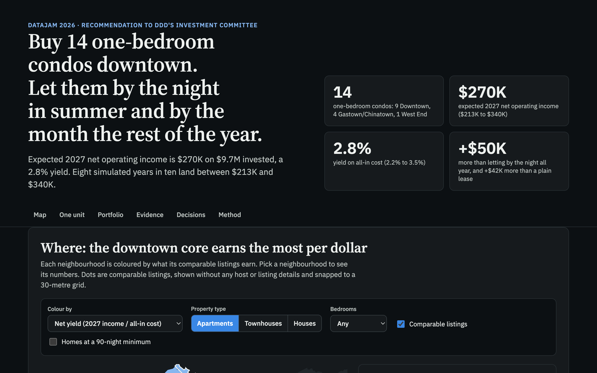

# The Airbnb Vancouver Problem

Where should a $10M fund buy short-term rentals in Vancouver, and how should it run them? A reproducible pipeline and interactive dashboard built for the SFU DSSS DataJam 2026, for an investment committee deciding where to put the money.

**Live dashboard:** https://pranay-ratan.github.io/airbnb-vancouver-datajam/ · **Code:** this repo

**Stack:** Python (pandas, NumPy) · Monte Carlo simulation · static HTML/JS dashboard and slide deck generated from the pipeline outputs

## Key results
All figures come from `outputs/metrics.json`; `tests/check_numbers.py` checks the deck and dashboard against it.

- **Recommendation:** buy 14 one-bedroom condos ($9.68M of the $10M budget): 9 in Downtown, 4 in Downtown Eastside (Gastown/Chinatown) and 1 in the West End.
- **Expected 2027 net operating income: $270K** (P10–P90: $213K–$340K), a **2.8%** median return on all-in cost.
- Comparables: 321 licensed listings, filtered from 6,509 in the 15 June 2026 Inside Airbnb snapshot.
- Inside Airbnb's own revenue and occupancy formulas are reproduced (revenue correlation 1.00, occupancy formula match 99.9%).

- **Operating plan:** rent by the night May to August and by the month (30+ nights) September to April.
- Return metric: 2027 NOI / (price + BC transfer tax + legal + furnishing), all cash.

Data: Inside Airbnb, Vancouver, 15 June 2026, CC BY 4.0. No host names, listing URLs or licence numbers are published anywhere in this repo.

## Run it locally
The outputs, dashboard and deck are committed, so you can open `outputs/dashboard/index.html` straight away. To rebuild everything from raw data:

1. Download from https://insideairbnb.com/get-the-data/ (Vancouver) into `data/raw/insideairbnb/<date>/` : `listings.csv.gz`, `calendar.csv.gz`, `reviews.csv.gz` for `2026-06-15` (the brief's dataset) and `2026-09-17`; `listings.csv.gz` for `2025-12-14` and `2026-03-21`; `neighbourhoods.geojson` in `data/raw/insideairbnb/`.
2. `pip install -r requirements.txt` then `./run_all.sh` (runs 9 scripts, builds the dashboard and deck, runs the tests).

## Trace any number
| Number on a slide | Script | Output |
|---|---|---|
| Funnel 6,509 → 1,037; data checks | `src/01_profile_clean.py` | `outputs/tables/cleaning_funnel.csv`, `data_profile.json` |
| June vs September price ratio (1.16, 1.14, up to 1.37) | `src/02_price_basis.py` | `price_ratios.csv`, `price_basis.json` |
| Month shares, price index, peak season | `src/03_seasonality.py` | `seasonality.json`, `monthly_stays.csv` |
| Yields by asset, neighbourhood; nightly vs lease vs hybrid per unit | `src/04_unit_economics.py` (costs in `src/assumptions.py`) | `asset_yields.csv`, `segment_yields.csv`, `operating_modes.csv` |
| Portfolio range, strategies, opt-out cases, sensitivities | `src/05_portfolio.py` | `strategies.csv`, `portfolio_modes.csv`, `sensitivity.csv`, `sim_draws.csv` |
| Validation checks | `src/06_validation.py` | `validation.json`, `snapshot_retest.csv`, `listing_age.csv` |
| Decision-log numbers | `src/07_decisions.py` | `decisions.json` |
| "Tested, did not hold" | `src/08_tests_not_held.py` | `tests_not_held.json` |
| Everything quoted in the deck and dashboard | `src/09_exports.py` | `outputs/metrics.json`, `outputs/dashboard_data.json` |

`deliverables/build_deck.py` reads only `metrics.json`, so each slide figure comes from the table above. `deliverables/dashboard_template.html` runs the same unit economics and a Monte Carlo in the browser (`outputs/dashboard/index.html`).

## Method in brief
Comparable listings: entire, licensed (City licence and BC registration both shown), nightly market, apartment/townhouse/3+ bedroom house, first review 12+ months before the scrape. June quotes are divided by the same-listing June/September ratio (the June file quotes World Cup weeks). Costs: Greater Vancouver REALTORS benchmark prices (Aug 2026), strata, property tax, upkeep, 15.5% Airbnb fee, manager and cleaning. Portfolios are filled with real comparable listings until $10M runs out, with demand, price, unit and licence-suspension shocks.

## Limits
One day's scrape; occupancy and revenue are Inside Airbnb estimates; licence status is an estimate; purchase prices are area benchmarks; furnished rent and off-season occupancy are assumptions; the vacancy-tax and tenancy reading needs counsel. See the deck appendix.

## AI use
Claude (Anthropic) wrote the pipeline, simulation, dashboard and slide text under the team's direction. Checks: Inside Airbnb's own revenue and occupancy formulas reproduced (`06_validation.py`), re-run on the September snapshot, and `tests/check_numbers.py` compares published figures with script output.
